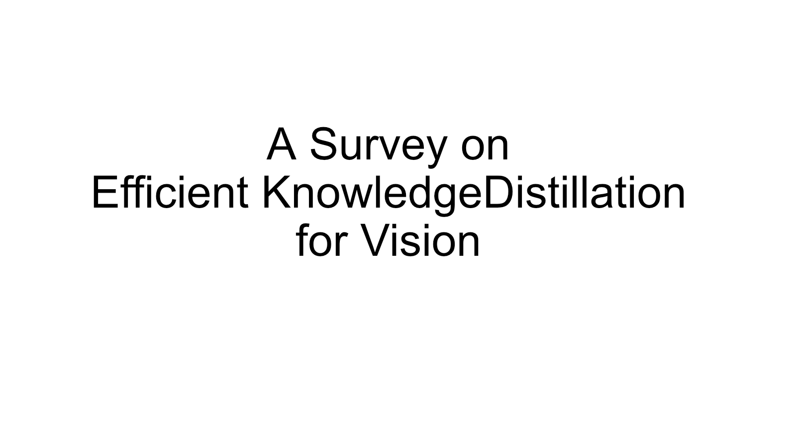
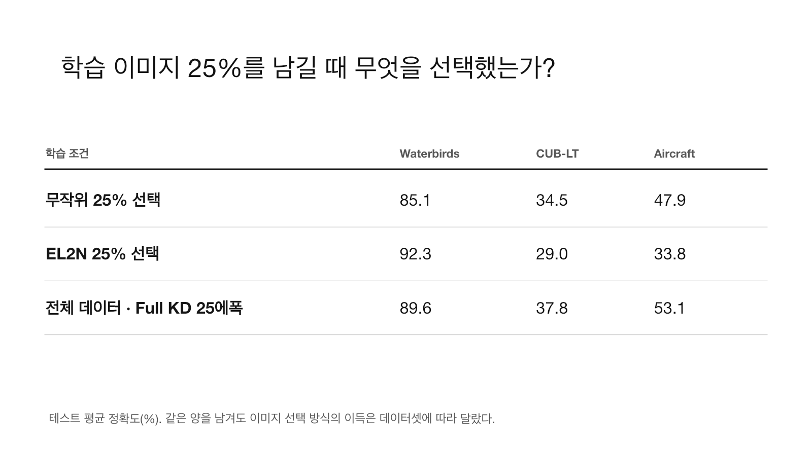
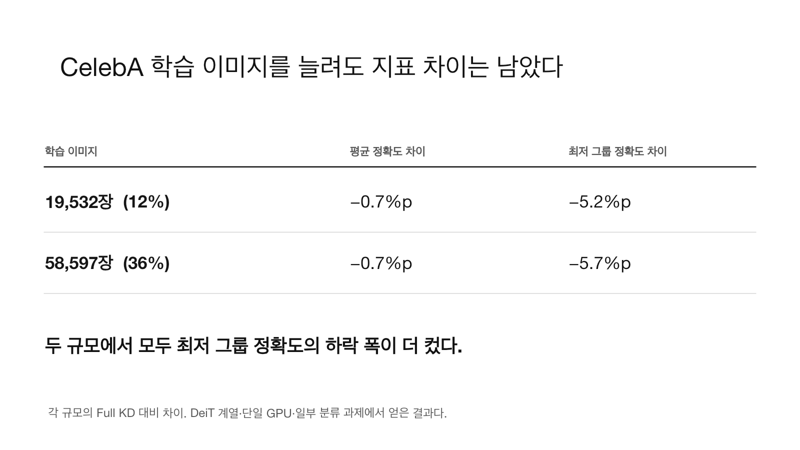
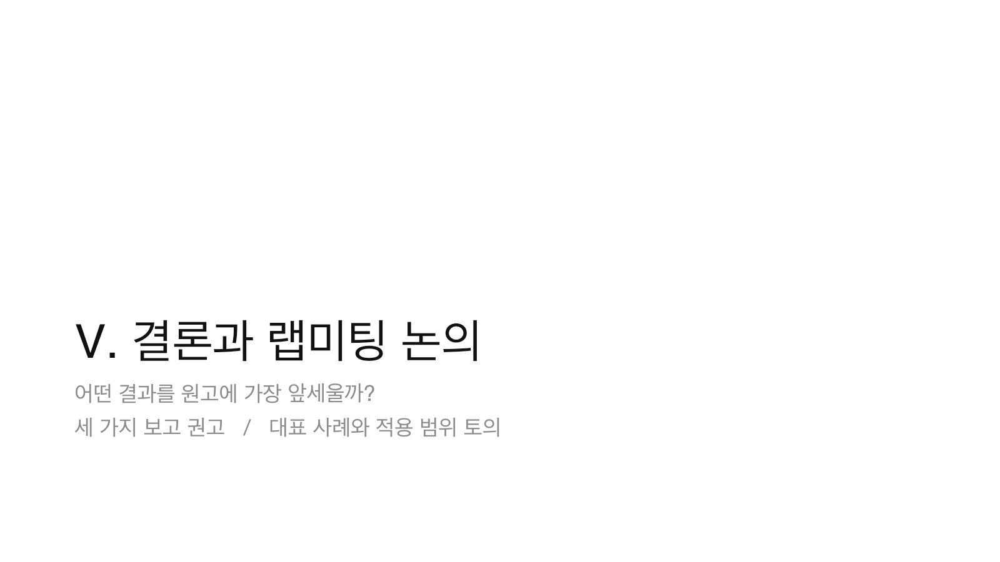

# 비전 지식 증류 랩미팅

[PowerPoint 다운로드](EKD-seminar.pptx) · [발표자 메모](storyboard.md) · [전체 슬라이드 미리보기](overview.jpg)

오늘 검토할 것은 **논문을 어떤 순서로 전개하는지**, 그리고 **각 실험이 그 전개에서 어떤 질문에 답하는지**다. 아래에서 각 장의 샘플 바로 밑에 설명을 읽을 수 있다.

| 원고의 큰 섹션 | 슬라이드 | 이 순서로 다루는 이유 |
|---|---|---|
| Ⅰ. 서론 | 2–4 | 어떤 질문을 논문의 중심에 둘까? |
| Ⅱ. 비용 산정과 기법 분류 | 5–7 | 기법을 비교하려면 무엇부터 정의해야 할까? |
| Ⅲ. 문헌의 보고 현황 | 8–9 | 문헌에서 답할 수 있는 질문은 어디까지인가? |
| Ⅳ. 실험 설계와 결과 | 10–17 | 각 대조 실험은 무엇을 구분하려고 했나? |
| Ⅴ. 결론과 랩미팅 논의 | 18–19 | 어떤 결과를 원고에 가장 앞세울까? |

### 01. A Survey on Efficient Knowledge Distillation for Vision

이번 랩미팅에서는 비용을 줄였다는 주장을 어떻게 비교할지, 그리고 그 비교를 위해 왜 이런 순서로 논문을 썼는지 설명한다.

## Ⅰ. 서론

비용을 세는 범위만 바꿔도 같은 연구의 절감률이 달라진다. 이 사례에서 출발해, 우리 실험이 답해야 할 질문을 비용과 성능으로 나눈다.

**섹션 구성**　TinyViT의 두 절감률 → 비용과 성능에 관한 두 질문

### 02. 섹션 도입

TinyViT 사례 하나로 두 질문이 자연스럽게 이어지는지 의견을 듣는다.

### 03. TinyViT의 학습 비용은 얼마나 줄었을까?

TinyViT는 같은 학습 기록에서도 학생 학습만 계산하면 57.7%, 로짓 생성까지 포함하면 29.8%가 절감된다. 57.7%는 원문 수치로 우리가 계산한 값이고, 29.8%는 원 논문의 보고값이다. 이 차이가 비용 범위를 먼저 정의한 이유다.

### 04. 논문은 두 가지 비교에서 출발한다

첫 질문은 교사 연산의 절감이 실제 학습 시간으로 얼마나 이어지는지다. 둘째 질문은 비슷한 시간에 학습했을 때 평균 정확도와 최저 그룹 정확도가 같은 방법을 지지하는지다. 이 두 질문을 먼저 제시해야 뒤의 실험을 읽는 기준이 생긴다.

## Ⅱ. 비용 산정과 기법 분류

먼저 교사·학생·준비 비용의 범위를 정의한다. 그다음 같은 교사 호출을 줄여도 학생이 받는 신호가 달라지는 사례로 네 축을 설명한다.

**섹션 구성**　한 번의 학생 학습에 드는 비용 → 줄이는 비용과 학생에게 남는 신호

### 05. 섹션 도입

이미지 Skip과 Reuse의 차이가 비용과 학습 신호 양쪽에서 분명한지 점검한다.

### 06. 학생 모델 한 개를 학습할 때 무엇을 셀까?

S1·S2는 연산량, S3·S4는 시간이다. 한 번 준비한 교사를 여러 학생이 공유하면 각 학생에게 배분할 비용이 달라진다. 그래서 총시간을 보고할 때에는 준비 비용을 몇 번의 학습에 나눴는지도 밝힌다.

### 07. 교사 호출이 줄어도 학생이 받는 신호는 다르다

이미지 Skip과 Reuse는 모두 교사 호출을 줄인다. 하지만 Skip에서 선택되지 않은 이미지는 정답 레이블로만 학습하고, Reuse는 이미 계산해 둔 교사 출력으로 증류를 계속한다. 네 축을 나눌 때 비용과 학습 신호를 함께 본 이유다.

## Ⅲ. 문헌의 보고 현황

각 논문이 어떤 값을 직접 보고했는지 집계한다. 합산 연산과 최저 그룹 정확도의 보고 빈도를 근거로, 다음 장에서 직접 측정할 항목을 고른 이유를 설명한다.

**섹션 구성**　40편의 선정 범위 → 지표별 보고 빈도 → 직접 비교가 필요한 항목

### 08. 섹션 도입

40편에서 확인한 빈도로 어디까지 말할 수 있는지 범위를 짚는다.

### 09. 40편에서 어떤 지표를 직접 보고했을까?

선정한 방법 논문 40편 가운데 합산 연산 변화율을 직접 보고한 논문은 두 편이었고, 최저 그룹 정확도 보고 사례는 찾지 못했다. 이 관찰을 근거로 우리 실험에서는 교사와 학생을 함께 세고 평균과 최저 그룹을 함께 평가했다.

## Ⅳ. 실험 설계와 결과

먼저 대조군을 선택한 이유를 설명한다. 학습 시간과 그룹 성능으로 두 질문에 답한 뒤, 토큰 선택·캐시·학습 이미지가 결과 해석에 미치는 영향을 하나씩 점검한다.

**섹션 구성**　비용 범위와 단축 Full KD → 예산·증강 뷰·데이터 선택 대조 → CelebA 규모 점검

### 10. 섹션 도입

비슷한 시간과 비슷한 갱신 횟수에 서로 다른 대조군을 쓴 이유가 충분히 드러나는지 본다.

### 11. 비교 대상마다 다른 질문에 답한다

100에폭 Full KD로 기본 비용과 성능을 정한다. 60·70에폭 Full KD는 절감 기법과 학습 시간이 비슷한 대조군이고, 25에폭 Full KD는 데이터 Skip과 학생 갱신 횟수가 비슷한 대조군이다. 각각 다른 차이를 확인하기 위해 넣었다.

### 12. 교사 연산을 약 75% 줄이면 학습 시간은?

학생 갱신 횟수를 유지하면 교사 연산을 약 75% 줄여도 루프에서 잰 시간은 31.0–39.5% 줄었다. 같은 DeiT-B의 준비 시간을 학생 학습 한 번에 모두 배분하면 총시간 절감률은 7.6–13.1%다. 어느 비용까지 세는지에 따라 첫 연구 질문의 답이 달라진다.

### 13. Waterbirds에서는 정확도 지표에 따라 순위가 바뀐다

Waterbirds에서 어텐션 Shrink는 463초, 70에폭 Full KD는 487초였다. 평균 정확도는 Shrink가 0.9%p 높고 최저 그룹 정확도는 3.9%p 낮았다. 세 시드 모두에서 방향이 같아 두 번째 연구 질문을 설명할 대표 사례로 골랐다.

### 14. 토큰을 15% 남기자 최저 그룹의 손실이 커졌다

여기서는 비교 기준을 100에폭 Full KD로 바꾼다. Waterbirds에서 교사 입력 토큰을 15% 남기면 평균 정확도는 1.0%p, 최저 그룹 정확도는 24.7%p 낮아졌다. 평균만으로는 예산을 줄일 때 어느 그룹에서 손실이 커지는지 보기 어렵다.

### 15. 같은 증강 뷰를 다시 계산하면 결과가 달라질까?

같은 증강 뷰를 같은 순서로 주고 교사 출력을 저장해 읽는 경우와 매번 다시 계산하는 경우를 짝지었다. 테스트 정확도는 18쌍 모두에서 일치했다. 이 대조가 뒷받침하는 권고는 캐시 크기와 함께 실제로 반복해 쓴 뷰 수도 기록하자는 것이다.

### 16. 학습 이미지 25%를 남길 때 무엇을 선택했는가?

이미지의 25%만 남겨도 EL2N 선택은 무작위 선택보다 Waterbirds에서 높고 CUB-LT와 Aircraft에서 낮았다. 전체 데이터를 짧게 학습한 조건을 함께 둬, 남긴 이미지와 줄어든 갱신 횟수를 구분해 비교할 수 있게 했다.

### 17. CelebA 학습 이미지를 늘려도 지표 차이는 남았다

CelebA에서는 학생 갱신 횟수를 고정하고 학습 이미지 수를 약 세 배로 늘렸다. 두 규모 모두 최저 그룹의 하락이 평균 하락보다 컸다. 테스트 평가 후 설계한 후속 실험이므로, 데이터 규모가 손실을 키웠다고 결론짓기보다 앞선 관찰의 범위를 점검하는 사례로 쓴다.

## Ⅴ. 결론과 랩미팅 논의

비용 범위, 비교 기준, 성능 지표라는 세 권고를 앞선 실험과 연결한다. 마지막에는 초록에 남길 사례와 결과를 일반화할 범위를 연구실에서 논의한다.

**섹션 구성**　세 가지 보고 권고 → 대표 사례와 적용 범위 토의

### 18. 섹션 도입

초록에는 Waterbirds의 순위 역전을 대표 사례로 둘지, CelebA 후속 결과는 논의에 남길지 의견을 구한다.

### 19. 실험 결과에서 도출한 세 가지 보고 항목

비용 범위에는 비용 실험, 비교 기준에는 단축 Full KD, 평가 지표에는 Waterbirds 결과가 각각 근거가 된다. 랩미팅에서는 이 가운데 초록에 남길 대표 사례와, 단일 GPU·DeiT 모델에서 얻은 결과를 어디까지 일반화할지 의견을 받는다.
