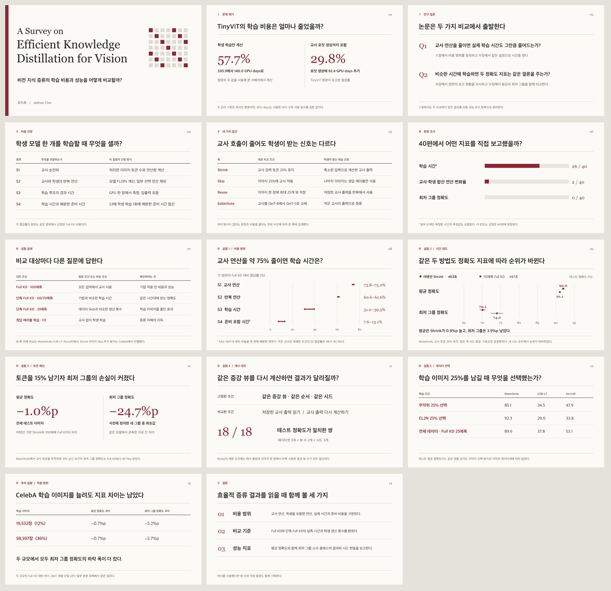

# A Survey on Efficient Knowledge Distillation for Vision

비전 지식 증류에서 교사의 연산을 줄이면 실제 학습 시간은 얼마나 짧아질까? 비슷한 시간 동안 학습한 모델을 비교할 때 평균 정확도와 최저 그룹 정확도는 같은 방법을 가리킬까? 두 질문을 중심으로 논문의 구성과 실험 설계를 설명하는 연구 세미나다.

[편집 가능한 PowerPoint](EKD-seminar.pptx) · [슬라이드별 발표 메모와 샘플](storyboard.md) · [전체 슬라이드 미리보기](overview.jpg)

## 왜 이 순서로 발표하는가

| 논문의 역할 | 슬라이드 | 청중에게 남길 내용 |
|---|---|---|
| Ⅰ. 문제와 질문 | 1–3 | TinyViT의 같은 학습 기록에서도 로짓 생성 비용을 포함하면 절감률이 달라진다. 이 사례에서 비용과 성능에 관한 두 질문을 도출한다. |
| Ⅱ. 비용과 분류 | 4–5 | S1–S4로 측정 범위를 정하고, 네 축에서 줄이는 비용과 학생에게 남는 학습 신호를 구별한다. |
| Ⅲ. 문헌의 보고 현황 | 6 | 선정한 40편에서 확인한 보고 빈도를 제시한다. 문헌에 부족한 비교가 뒤의 통제 실험을 설계한 이유다. |
| Ⅳ. 실험과 해석 | 7–13 | 각 베이스라인의 역할을 밝힌 뒤 비용, 비슷한 시간에서의 성능, 토큰 선택, 캐시 대조, 데이터 선택과 규모를 차례로 검토한다. |
| Ⅴ. 결론 | 14 | 실제 결과를 근거로 비용 범위, 시간과 갱신 횟수가 명시된 베이스라인, 그룹·클래스별 성능을 함께 보고하자고 제안한다. |

## 실험별로 무엇을 보여 주려 했는가

| 장 | 비교 설계 | 결과를 읽는 관점 |
|---|---|---|
| 8 | 학생 갱신을 유지하고 약 25% 교사 예산 조건을 같은 범위의 Full KD와 비교 | 교사 연산 절감률이 학습 시간에 얼마나 반영되는가? 범위선은 조건·데이터셋 평균 간 범위이며, 오차 막대가 아니다. S4에는 학생 학습 1회에 배분한 준비 시간이 들어간다. |
| 9 | Waterbirds에서 25% 토큰 Shrink와 70에폭 Full KD 비교 | 실측 시간이 463초와 487초로 가까운 두 방법의 순위가 평균과 최저 그룹에서 갈리는가? |
| 10 | Waterbirds에서 토큰 15% Shrink를 100에폭 Full KD와 비교 | 예산을 더 줄일 때 평균이 가리는 손실이 있는가? 토큰을 어떻게 선택했는지도 함께 본다. |
| 11 | 같은 증강 뷰·순서·시드를 사용하고, 캐시 읽기와 교사 재계산만 교체 | 출력 저장 방식을 바꿨을 때 관측한 차이와, Full KD 대비 차이를 구분한다. |
| 12 | 25% 데이터를 무작위 또는 EL2N으로 선택하고 전체 데이터 25에폭과 비교 | 갱신 횟수가 비슷할 때도 선택 방식의 이득이 데이터셋마다 같은가? |
| 13 | CelebA에서 학생 갱신을 고정하고 학습 이미지 수를 약 세 배로 확대 | 작은 부분집합에서 본 평균·최저 그룹 차이가 더 큰 부분집합에도 나타나는가? 테스트 평가 후 설계한 후속 실험이다. |

발표 자료의 표·그림 번호는 발표에 사용한 최종 원고를 기준으로 한다. 슬라이드 2의 TinyViT 재계산과 슬라이드 8의 S1·S2 계산값, S3 실측값, S4 합산값은 측정 방식이 다르다. 슬라이드 9의 오차선은 시드 간 표준편차다.
