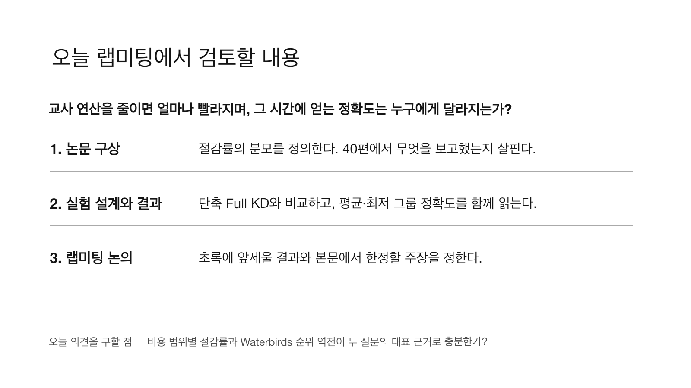
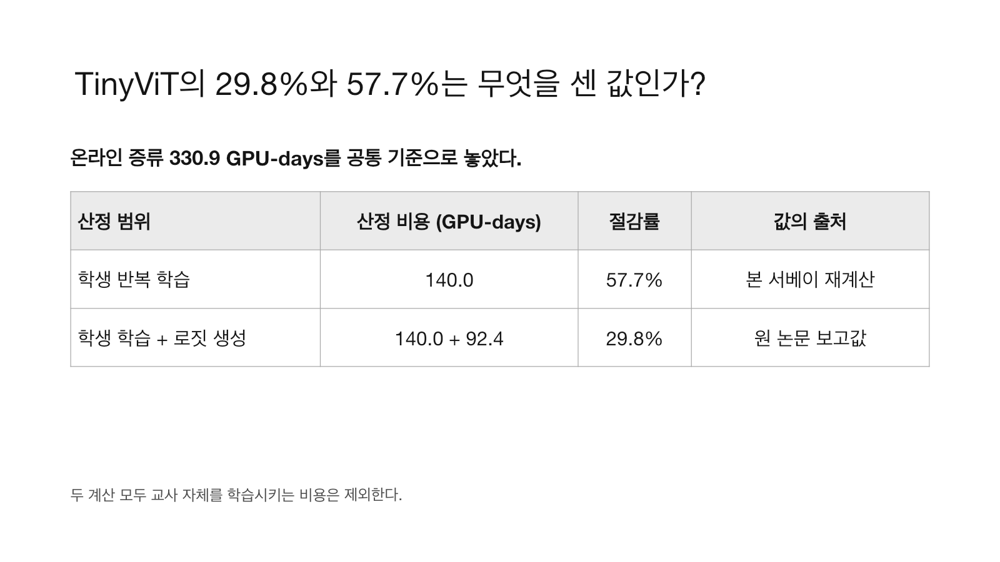
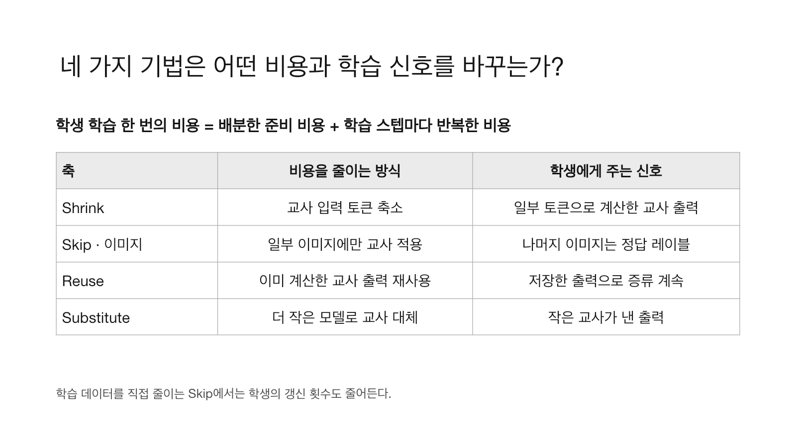
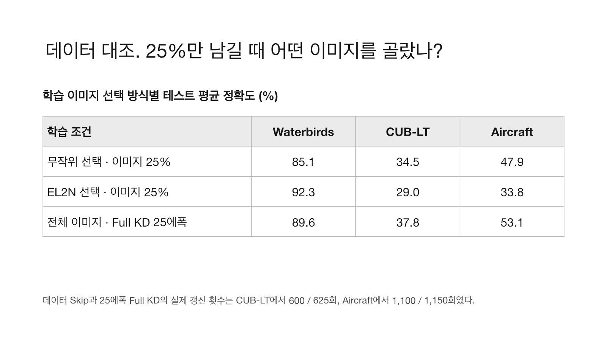
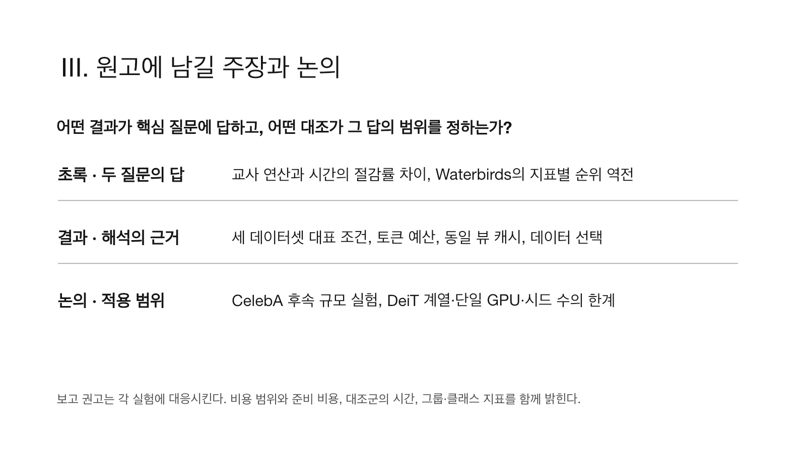

# 비전 지식 증류 랩미팅

교사 연산을 줄인 만큼 실제 학습 시간도 줄어드는가? 비슷한 시간에 학습한 모델을 평균 정확도와 최저 그룹 정확도로 비교하면 같은 결론에 이르는가? 이번 랩미팅에서는 원고가 이 두 질문을 어떤 순서로 제기하는지, 각 실험표가 어느 질문에 답하는지, 초록에 어떤 근거를 남길지 검토한다.

[편집 가능한 PowerPoint](EKD-seminar.pptx) · [전체 미리보기](overview.jpg) · [페이지별 발표 메모](storyboard.md)

| 큰 섹션 | 쪽 | 이 섹션에서 다룰 내용 |
|---|---|---|
| [논문 구상과 문헌 근거](#paper) | 3–6 | TinyViT 사례에서 비용 범위를 정의하고, 네 가지 기법의 차이와 40편의 보고 현황을 살펴본다. |
| [실험 설계와 결과](#tests) | 7–14 | 대조군을 고른 이유를 먼저 보고, 비용 범위별 결과와 세 데이터셋의 정확도를 비교한다. 예산·캐시·데이터 선택·규모 대조로 해석을 좁힌다. |
| [원고에 남길 주장과 논의](#decisions) | 15–16 | 두 질문에 직접 답하는 결과와 적용 범위를 보강하는 대조를 구분해 초록·결과·논의의 배치안을 검토한다. |

### 01. A Survey on Efficient Knowledge Distillation for Vision

이번 랩미팅에서는 논문의 논증 순서와 그 순서를 뒷받침하는 실험을 함께 검토한다.

근거　첨부한 발표 표지

### 02. 오늘 랩미팅에서 검토할 내용

목표는 비용과 성능에 관한 두 질문을 어떤 순서로 제기하고, 어떤 대조군으로 답할지 검토하는 것이다. 먼저 논문을 이렇게 구성한 이유를 공유하고, 실제 결과표를 읽은 뒤 초록에 실을 대표 사례와 해석의 범위를 논의한다.

근거　Ⅰ장 연구 질문 · Ⅳ장 실험 · Ⅴ장 결론

## 논문 구상과 문헌 근거

TinyViT 사례에서 비용 범위를 정의하고, 네 가지 기법의 차이와 40편의 보고 현황을 살펴본다.

### 03. Ⅰ. 논문 구상과 문헌 근거

원고 전반부는 문제 제기, 비용 범위 정의, 문헌 점검 순서로 설계했다. 비용을 세는 기준을 먼저 정해야 기존 논문의 수치를 같은 뜻으로 잘못 읽지 않고, 문헌만으로 해결하기 어려운 질문도 식별할 수 있다.

근거　원고 Ⅰ–Ⅲ장

### 04. TinyViT의 29.8%와 57.7%는 무엇을 센 값인가?

같은 온라인 증류 기준 330.9 GPU-days에서 출발한다. 학생 반복 학습은 140.0이고 로짓 생성에는 92.4가 더 든다. 저자가 보고한 29.8%와 우리가 재계산한 57.7%를 구분하면, 측정 범위를 정의할 필요가 한 사례로 드러난다.

근거　Ⅲ-2 · 표 3 · TinyViT (ECCV 2022), https://arxiv.org/abs/2207.10666

표를 텍스트로 보기

| 산정 범위 | 산정 비용 (GPU-days) | 절감률 | 값의 출처 |
|---|---|---|---|
| 학생 반복 학습 | 140.0 | 57.7% | 본 서베이 재계산 |
| 학생 학습 + 로짓 생성 | 140.0 + 92.4 | 29.8% | 원 논문 보고값 |

### 05. 네 가지 기법은 어떤 비용과 학습 신호를 바꾸는가?

분류는 모델 이름 대신 줄이는 비용에서 출발한다. 특히 이미지 Skip은 교사를 적용하지 않은 이미지에 정답만 주고, Reuse는 이전에 얻은 교사 출력으로 증류를 이어 간다. 이 차이가 두 축을 분리한 이유다.

근거　Ⅱ-2–3 · 식 (1) · 표 1

표를 텍스트로 보기

| 축 | 비용을 줄이는 방식 | 학생에게 주는 신호 |
|---|---|---|
| Shrink | 교사 입력 토큰 축소 | 일부 토큰으로 계산한 교사 출력 |
| Skip · 이미지 | 일부 이미지에만 교사 적용 | 나머지 이미지는 정답 레이블 |
| Reuse | 이미 계산한 교사 출력 재사용 | 저장한 출력으로 증류 계속 |
| Substitute | 더 작은 모델로 교사 대체 | 작은 교사가 낸 출력 |

### 06. 선정한 40편에서는 무엇을 수치로 보고했나?

초기 후보 44편 중 35편, 보완 검색의 신규 후보 15편 중 5편을 포함했다. 합산 변화율은 두 모델을 합한 변화를 직접 보고해야 수치로 셌다. 최저 그룹 정확도 0편은 이 표본에서 보고 사례를 찾지 못했다는 뜻이며, 모든 연구에서 계산 가능했다는 뜻은 아니다.

근거　Ⅲ-1 · 표 2 · 부록 표 7

표를 텍스트로 보기

| 수치 보고 항목 | 편수 | 판정 기준 |
|---|---|---|
| 학습 시간 | 26 / 40 | 일부 단계의 측정값·추정값도 포함 |
| 교사·학생 합산 연산 변화율 | 2 / 40 | 두 모델을 합한 변화율을 저자가 직접 제시 |
| 최저 그룹 정확도 | 0 / 40 | 사전에 정의한 그룹 중 가장 낮은 정확도 |

## 실험 설계와 결과

대조군을 고른 이유를 먼저 보고, 비용 범위별 결과와 세 데이터셋의 정확도를 비교한다. 예산·캐시·데이터 선택·규모 대조로 해석을 좁힌다.

### 07. Ⅱ. 실험 설계와 결과

질문마다 대조군을 바꾼다. 비용 질문에는 동일한 범위의 100에폭 Full KD를, 시간 질문에는 60·70에폭 Full KD를 쓴다. 이어서 예산, 캐시, 데이터 선택과 규모를 따로 비교해 결론이 성립하는 조건을 살핀다.

근거　Ⅳ-1–3 · 표 4–5 · 그림 2–4

표를 텍스트로 보기

| 질문 | 대조 설계 | 볼 결과 |
|---|---|---|
| 실제로 얼마나 빨라지나? | 학생 갱신 유지 · 100에폭 Full KD 기준 | 교사 FLOPs와 학습 시간 |
| 비슷한 시간에 무엇을 얻나? | 60·70에폭 단축 Full KD와 비교 | 평균·최저 그룹 정확도 |
| 어떤 조건에 민감한가? | 토큰 예산, 뷰, 선택 이미지, 데이터 규모 변경 | 그룹·클래스별 차이 |

### 08. 실험 1. 교사 연산과 실제 시간은 얼마나 줄었나?

각 행에서 분모는 같은 범위의 Full KD다. 학생 갱신을 유지한 조건의 교사 연산은 약 75% 줄었지만, 학습 시간 절감은 31.0–39.5%였다. S4에서 DeiT-B 유지와 DeiT-S 대체를 분리한 이유는 교사 준비 시간 자체가 달라지기 때문이다.

근거　Ⅳ-2 가 · 그림 2 수치를 표로 재구성

표를 텍스트로 보기

| 산정 범위 | 절감률 | 산정 방법 / 조건 |
|---|---|---|
| S1  교사 연산 | 73.8–75.0% | 처리한 이미지·토큰 수로 계산 |
| S2  반복 연산 | 60.6–61.6% | 교사·학생 FLOPs, 일부 선택 연산 제외 |
| S3  학습 시간 | 31.0–39.5% | RTX A5000에서 루프 경과 시간 실측 |
| S4  준비 포함 · DeiT-B 유지 | 7.6–13.1% | 교사 준비 시간을 학생 학습 1회에 배분 |
| S4  준비 포함 · DeiT-S 대체 | 48.0–50.3% | 작은 교사의 준비 시간을 같은 방식으로 배분 |

### 09. 실험 2. 네 축의 대표 조건을 같은 표에서 비교하면?

원고 표 5의 대표 행을 그대로 옮겼다. 세 데이터셋의 평균과 함께 Waterbirds 최저 그룹, CUB-LT 소수 클래스도 읽는다. 예산의 대상이 토큰, 이미지, 뷰, 교사 모델로 서로 다르므로 실제 학습 시간이 비슷한 단축 Full KD를 다음 장에서 구체적으로 비교한다.

근거　Ⅳ-2 나·라 · 표 5 대표 행 발췌 · 테스트 정확도

표를 텍스트로 보기

| 학습 조건 | WB 평균 | WB 최저 | CUB 평균 | CUB 소수 | Air 평균 |
|---|---|---|---|---|---|
| Full KD · 100에폭 | 91.1 | 73.3 | 68.2 | 54.3 | 71.0 |
| 단축 Full KD · 70에폭 | 91.1 | 74.0 | 61.3 | 41.3 | 67.4 |
| Shrink · 어텐션 토큰 25% | 92.0 | 70.1 | 67.6 | 53.7 | 70.1 |
| 이미지 Skip · 불확실성 상위 25% | 90.5 | 72.3 | 62.0 | 43.0 | 69.0 |
| Reuse · 이미지당 최대 25뷰 | 90.4 | 69.5 | 67.6 | 53.4 | 69.7 |
| Substitute · DeiT-S 교사 | 91.8 | 74.0 | 66.7 | 51.4 | 71.8 |

### 10. 실험 2. Waterbirds에서 두 방법의 순위가 바뀐다

어텐션 Shrink가 24초 빨랐고 평균 정확도는 0.9%p 높았지만 최저 그룹 정확도는 3.9%p 낮았다. 이 방향은 세 시드에서 모두 같았다. 학습 시간은 근사적으로 맞춘 실측값이므로 정확히 같은 시간에서의 비교로 해석하지 않는다.

근거　Ⅳ-2 라 · 표 5 · 그림 4 · Waterbirds 테스트

표를 텍스트로 보기

| 조건 | 학습 시간 | 평균 정확도 | 최저 그룹 정확도 |
|---|---|---|---|
| 어텐션 Shrink · 토큰 25% | 463초 | 92.0 ± 0.4% | 70.1 ± 0.8% |
| 단축 Full KD · 70에폭 | 487초 | 91.1 ± 0.1% | 74.0 ± 1.7% |
| Shrink − 단축 Full KD | −24초 | +0.9%p | −3.9%p |

### 11. 예산 대조. 남긴 토큰과 선택 방식에 따라 무엇이 달라지나?

같은 Waterbirds에서 토큰 유지율을 바꾸면 선택 방식의 순위까지 달라진다. 25%에서는 어텐션 기반 선택의 최저 그룹 정확도가 높았지만 6%에서는 무작위 선택이 높았다. 따라서 한 예산에서 관측한 우위를 모든 예산으로 일반화하기 어렵다.

근거　Ⅳ-2 다 · 그림 3 · 표 5, Waterbirds 최저 그룹 정확도

표를 텍스트로 보기

| 교사 토큰 유지율 | 어텐션 기반 선택 | 무작위 선택 |
|---|---|---|
| 25% | 70.1 | 45.6 |
| 6% | 15.7 | 25.0 |

### 12. 캐시 대조. 출력을 읽거나 다시 계산하면 결과가 달라지나?

두 조건에서 뷰와 순서, 시드를 일치시켰다. 표는 Waterbirds에서 시드별 최저 그룹 정확도를 직접 보여 준다. 세 데이터셋, 두 뷰 수, 세 시드를 조합한 18쌍에서도 캐시와 재계산 조건의 테스트 평균 정확도가 일치했다. 캐시 용량과 사용한 뷰 수를 함께 보고할 근거다.

근거　Ⅳ-2 나 · 동일 뷰 캐시/온라인 대조, Waterbirds 시드별 테스트 기록

표를 텍스트로 보기

| 이미지당 최대 뷰 수 | 교사 출력 처리 | 시드 1 | 시드 2 | 시드 3 |
|---|---|---|---|---|
| 15개 | 캐시에서 읽기 | 69.78 | 64.17 | 67.60 |
| 15개 | 동일 뷰에서 재계산 | 69.78 | 64.17 | 67.60 |
| 25개 | 캐시에서 읽기 | 70.72 | 66.98 | 70.72 |
| 25개 | 동일 뷰에서 재계산 | 70.72 | 66.98 | 70.72 |

### 13. 데이터 대조. 25%만 남길 때 어떤 이미지를 골랐나?

학습 이미지 수를 줄이면 학생 갱신도 줄기 때문에 전체 데이터를 25에폭 학습한 비교군을 둔다. 같은 25%에서 EL2N은 Waterbirds의 평균 정확도를 높였지만 CUB-LT와 Aircraft에서는 무작위 선택보다 낮았다.

근거　Ⅳ-2 마 · 표 5 해당 행, 테스트 평균 정확도

표를 텍스트로 보기

| 학습 조건 | Waterbirds | CUB-LT | Aircraft |
|---|---|---|---|
| 무작위 선택 · 이미지 25% | 85.1 | 34.5 | 47.9 |
| EL2N 선택 · 이미지 25% | 92.3 | 29.0 | 33.8 |
| 전체 이미지 · Full KD 25에폭 | 89.6 | 37.8 | 53.1 |

### 14. 규모 대조. 학습 이미지를 늘려도 그룹 손실이 남나?

테스트 평가 후 CelebA에서 학생 갱신 횟수를 고정하고 학습 이미지를 약 세 배로 늘렸다. 두 규모 모두 최저 그룹 하락이 평균 하락보다 컸다. 규모 간 0.5%p 차이가 규모 자체의 효과인지는 이 실험으로 결론짓기 어렵다.

근거　Ⅳ-3 · CelebA 후속 실험 · 테스트, 시드 3개

표를 텍스트로 보기

| CelebA 학습 이미지 | 평균 정확도 차이 | 최저 그룹 정확도 차이 |
|---|---|---|
| 19,532장 (12%) | −0.7%p | −5.2%p |
| 58,597장 (36%) | −0.7%p | −5.7%p |

## 원고에 남길 주장과 논의

두 질문에 직접 답하는 결과와 적용 범위를 보강하는 대조를 구분해 초록·결과·논의의 배치안을 검토한다.

### 15. Ⅲ. 원고에 남길 주장과 논의

실험표에서 직접 읽히는 두 관찰을 초록에 두고, 캐시·선택·규모 대조는 그 해석의 조건으로 본문에 배치하는 안이다. 이 구분을 먼저 제안한 뒤 적용 범위와 대표 사례에 대한 피드백을 받는다.

근거　Ⅳ-3 · Ⅴ장 · 표 6

### 16. 랩미팅에서 결정할 두 가지

제안은 비용 범위와 비슷한 시간의 성능을 초록의 두 결과로 삼는 것이다. 연구실에는 Waterbirds 사례가 둘째 질문을 충분히 대표하는지, CelebA 규모 후속 실험을 본문 논의에 두는 편이 적절한지 의견을 구한다.

근거　Ⅰ장 연구 질문 · Ⅳ-2 라 · Ⅳ-3 · Ⅴ장
