# 랩미팅 발표자 메모

[그림과 페이지별 설명](README.md) · [PowerPoint](EKD-seminar.pptx)

## 01. A Survey on Efficient Knowledge Distillation for Vision

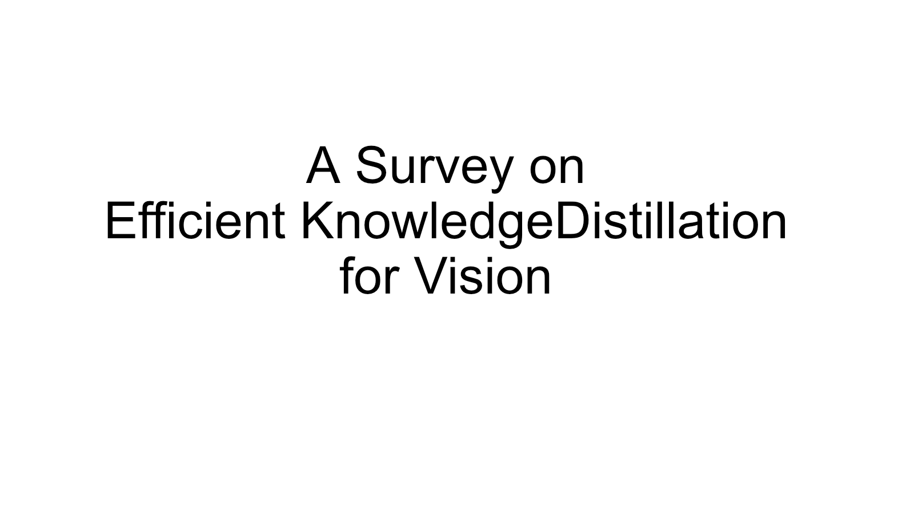

이번 랩미팅에서는 비용을 줄였다는 주장을 어떻게 비교할지, 그리고 그 비교를 위해 왜 이런 순서로 논문을 썼는지 설명한다.

오늘 검토할 논문의 제목이다.

**원고 근거**　국문 요약 · Ⅰ장

## 02. Ⅰ. 서론

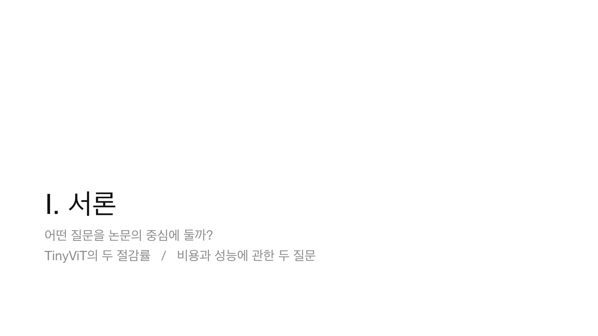

TinyViT 사례 하나로 두 질문이 자연스럽게 이어지는지 의견을 듣는다.

비용을 세는 범위만 바꿔도 같은 연구의 절감률이 달라진다. 이 사례에서 출발해, 우리 실험이 답해야 할 질문을 비용과 성능으로 나눈다.

**원고 근거**　Ⅰ장 · Ⅲ-2 표 3

## 03. TinyViT의 학습 비용은 얼마나 줄었을까?

TinyViT는 같은 학습 기록에서도 학생 학습만 계산하면 57.7%, 로짓 생성까지 포함하면 29.8%가 절감된다. 57.7%는 원문 수치로 우리가 계산한 값이고, 29.8%는 원 논문의 보고값이다. 이 차이가 비용 범위를 먼저 정의한 이유다.

온라인 증류를 기준으로 학생 반복 학습에 든 GPU-days만 비교하면 330.9에서 140.0으로 줄었다. 캐시를 만들기 위한 로짓 생성에 92.4 GPU-days가 더 든다. 이를 더해야 원 논문이 보고한 29.8%가 나온다. 교사 자체의 학습 비용은 여기서도 빠져 있다.

**원고 근거**　Ⅲ-2 · 표 3 · Wu 등, TinyViT (ECCV 2022), https://arxiv.org/abs/2207.10666

## 04. 논문은 두 가지 비교에서 출발한다

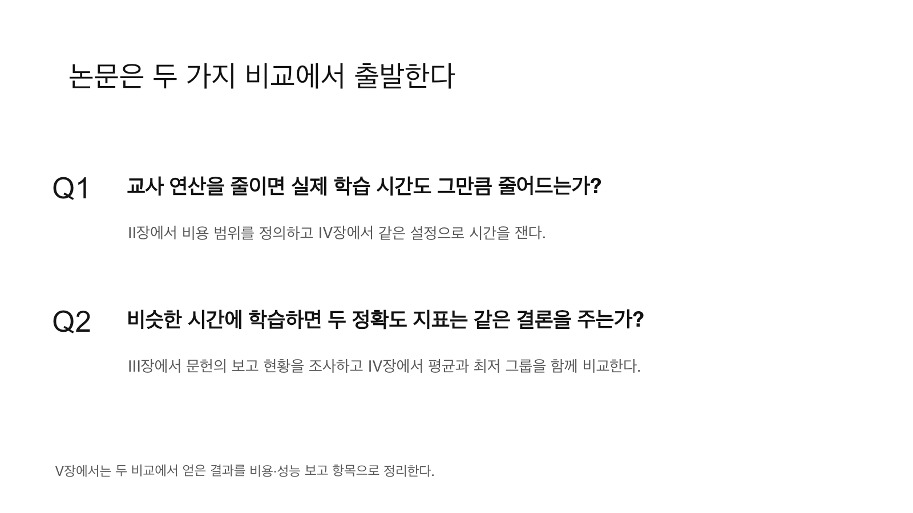

첫 질문은 교사 연산의 절감이 실제 학습 시간으로 얼마나 이어지는지다. 둘째 질문은 비슷한 시간에 학습했을 때 평균 정확도와 최저 그룹 정확도가 같은 방법을 지지하는지다. 이 두 질문을 먼저 제시해야 뒤의 실험을 읽는 기준이 생긴다.

첫 질문에 답하려면 교사 연산, 학생 연산, 경과 시간을 나눠야 한다. 둘째 질문에는 같은 기계를 쓴 대조군과 그룹별 성능이 필요하다. 이 때문에 문헌 분류 뒤에 직접 비교 실험을 배치했다.

**원고 근거**　Ⅰ장 마지막 문단 · Ⅱ–Ⅴ장 구성

## 05. Ⅱ. 비용 산정과 기법 분류

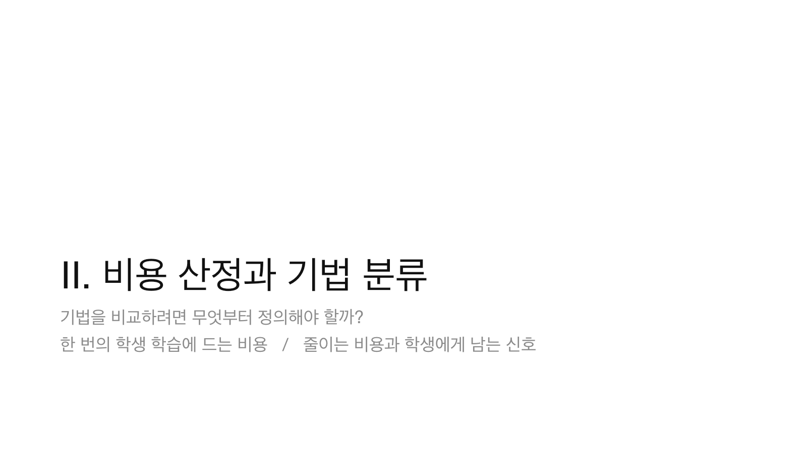

이미지 Skip과 Reuse의 차이가 비용과 학습 신호 양쪽에서 분명한지 점검한다.

먼저 교사·학생·준비 비용의 범위를 정의한다. 그다음 같은 교사 호출을 줄여도 학생이 받는 신호가 달라지는 사례로 네 축을 설명한다.

**원고 근거**　Ⅱ-2 식 (1) · Ⅱ-3 표 1

## 06. 학생 모델 한 개를 학습할 때 무엇을 셀까?

S1·S2는 연산량, S3·S4는 시간이다. 한 번 준비한 교사를 여러 학생이 공유하면 각 학생에게 배분할 비용이 달라진다. 그래서 총시간을 보고할 때에는 준비 비용을 몇 번의 학습에 나눴는지도 밝힌다.

Full KD의 기본 스텝은 교사의 순전파와 학생의 순전파·역전파다. 기법에 따라 선택 연산과 데이터 읽기가 더해진다. 한 번 준비한 결과를 여러 학생이 공유하면 각 학생에 배분하는 준비 비용은 줄어든다. 저장 용량은 바이트로 따로 보고한다.

**원고 근거**　Ⅱ-2 · 식 (1) · 그림 1

## 07. 교사 호출이 줄어도 학생이 받는 신호는 다르다

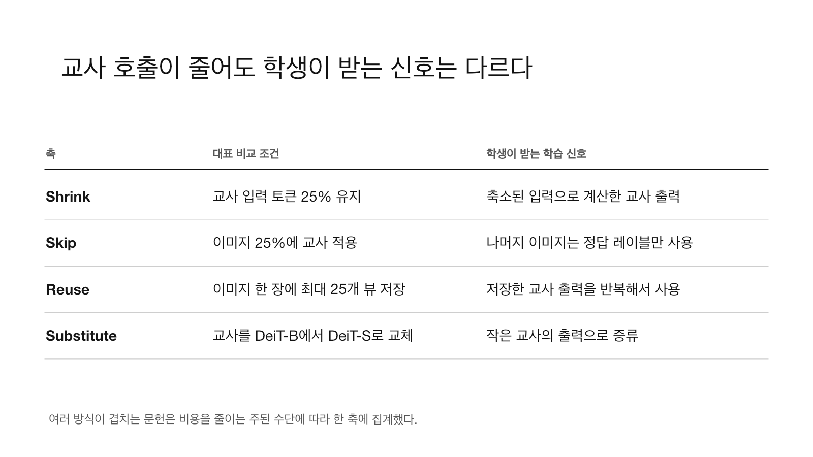

이미지 Skip과 Reuse는 모두 교사 호출을 줄인다. 하지만 Skip에서 선택되지 않은 이미지는 정답 레이블로만 학습하고, Reuse는 이미 계산해 둔 교사 출력으로 증류를 계속한다. 네 축을 나눌 때 비용과 학습 신호를 함께 본 이유다.

특히 이미지 Skip과 Reuse를 구분한다. Skip에서 교사를 적용하지 않은 이미지는 정답 레이블로 학습한다. Reuse는 교사를 다시 실행하지 않아도 이미 계산한 교사 출력으로 증류를 계속한다. 데이터 Skip은 이미지 자체를 빼므로 학생 갱신까지 줄어든다.

**원고 근거**　Ⅱ-3 · 표 1 · Ⅳ-1 가

## 08. Ⅲ. 문헌의 보고 현황

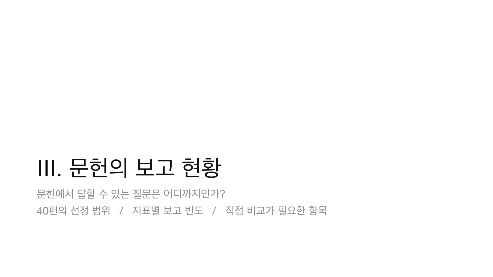

40편에서 확인한 빈도로 어디까지 말할 수 있는지 범위를 짚는다.

각 논문이 어떤 값을 직접 보고했는지 집계한다. 합산 연산과 최저 그룹 정확도의 보고 빈도를 근거로, 다음 장에서 직접 측정할 항목을 고른 이유를 설명한다.

**원고 근거**　Ⅲ-1 표 2 · 부록 표 7

## 09. 40편에서 어떤 지표를 직접 보고했을까?

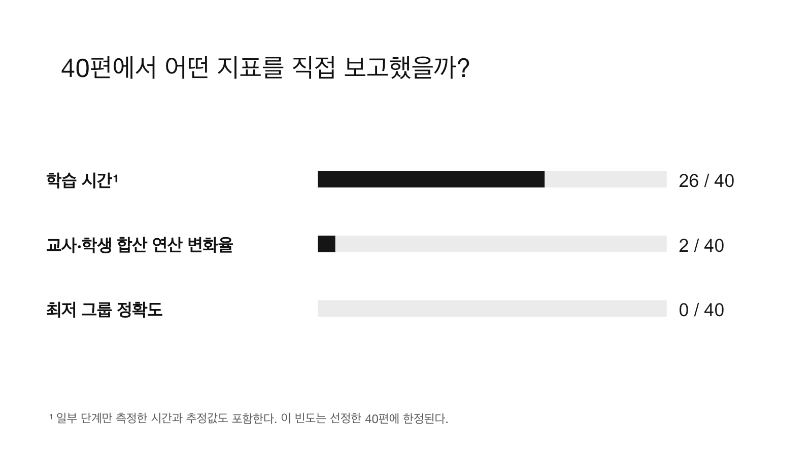

선정한 방법 논문 40편 가운데 합산 연산 변화율을 직접 보고한 논문은 두 편이었고, 최저 그룹 정확도 보고 사례는 찾지 못했다. 이 관찰을 근거로 우리 실험에서는 교사와 학생을 함께 세고 평균과 최저 그룹을 함께 평가했다.

초기 후보 44편에서 35편, 보완 검색 신규 후보 15편에서 5편을 선정했다. 합산 연산 변화율은 두 모델을 합쳐 변화를 직접 수치로 제시한 UNIX와 HACD만 집계했다. 그룹 주석의 유무는 조사하지 않았으므로 최저 그룹 정확도 0편은 보고 사례를 찾지 못했다는 뜻이다.

**원고 근거**　Ⅱ-1 · Ⅲ-1 · 표 2 · 부록 표 7

## 10. Ⅳ. 실험 설계와 결과

비슷한 시간과 비슷한 갱신 횟수에 서로 다른 대조군을 쓴 이유가 충분히 드러나는지 본다.

먼저 대조군을 선택한 이유를 설명한다. 학습 시간과 그룹 성능으로 두 질문에 답한 뒤, 토큰 선택·캐시·학습 이미지가 결과 해석에 미치는 영향을 하나씩 점검한다.

**원고 근거**　Ⅳ-1–3 · 표 4–5 · 그림 2–4

## 11. 비교 대상마다 다른 질문에 답한다

100에폭 Full KD로 기본 비용과 성능을 정한다. 60·70에폭 Full KD는 절감 기법과 학습 시간이 비슷한 대조군이고, 25에폭 Full KD는 데이터 Skip과 학생 갱신 횟수가 비슷한 대조군이다. 각각 다른 차이를 확인하기 위해 넣었다.

주 실험은 Waterbirds, CUB-LT, Aircraft에서 네 축을 모두 비교한다. CelebA에서는 Shrink와 이미지 Skip만 추가 평가한다. 기본 모델은 DeiT-B 교사와 DeiT-Ti 학생이며, 정확도는 조건별 3–5개 시드의 테스트 결과를 사용한다. 짧은 Full KD는 학습률 스케줄도 함께 단축했다.

**원고 근거**　Ⅳ-1 가–다 · 표 4

## 12. 교사 연산을 약 75% 줄이면 학습 시간은?

학생 갱신 횟수를 유지하면 교사 연산을 약 75% 줄여도 루프에서 잰 시간은 31.0–39.5% 줄었다. 같은 DeiT-B의 준비 시간을 학생 학습 한 번에 모두 배분하면 총시간 절감률은 7.6–13.1%다. 어느 비용까지 세는지에 따라 첫 연구 질문의 답이 달라진다.

교사 연산량과 계측한 반복 연산량은 처리량으로 계산한 값이다. S3는 RTX A5000의 루프 경과 시간이다. 같은 DeiT-B 준비 비용을 학생 한 명이 전부 부담하면 총시간 절감률은 더 낮다. 작은 교사로 대체하면 준비 시간 자체가 짧아져 결과가 달라진다.

**원고 근거**　Ⅳ-2 가 · 그림 2 · 학생 갱신 유지, 새 캐시 포함, 기존 캐시 재사용 및 데이터 Skip 제외

## 13. Waterbirds에서는 정확도 지표에 따라 순위가 바뀐다

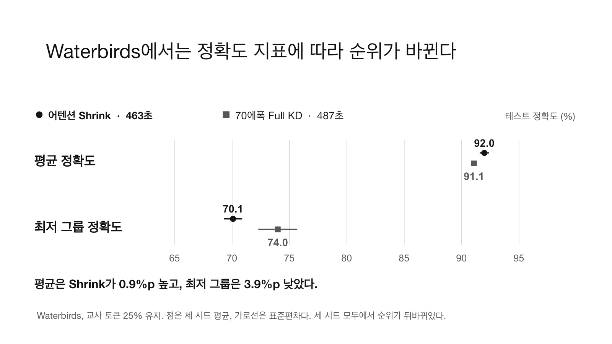

Waterbirds에서 어텐션 Shrink는 463초, 70에폭 Full KD는 487초였다. 평균 정확도는 Shrink가 0.9%p 높고 최저 그룹 정확도는 3.9%p 낮았다. 세 시드 모두에서 방향이 같아 두 번째 연구 질문을 설명할 대표 사례로 골랐다.

Waterbirds에서 토큰 25%를 남긴 어텐션 Shrink는 463초, 70에폭 Full KD는 487초가 걸렸다. 세 시드에서 모두 Shrink가 평균에서는 앞서고 최저 그룹에서는 뒤졌다. 시간은 근사 대조이며, 세 시드 관측을 다른 데이터셋의 보편적 순위로 해석하지 않는다. CUB-LT와 Aircraft에서는 Reuse, Substitute, 어텐션 Shrink 모두 두 단축 베이스라인보다 평균 정확도가 높았다.

**원고 근거**　Ⅳ-2 라 · 표 5 · 그림 4 · Waterbirds 테스트 평균 ± 시드 간 표준편차, n=3

## 14. 토큰을 15% 남기자 최저 그룹의 손실이 커졌다

여기서는 비교 기준을 100에폭 Full KD로 바꾼다. Waterbirds에서 교사 입력 토큰을 15% 남기면 평균 정확도는 1.0%p, 최저 그룹 정확도는 24.7%p 낮아졌다. 평균만으로는 예산을 줄일 때 어느 그룹에서 손실이 커지는지 보기 어렵다.

이번 비교 기준은 70에폭이 아니라 100에폭 Full KD다. Waterbirds에서 어텐션으로 교사 입력 토큰의 15%를 유지했을 때 평균은 1.0%p, 최저 그룹은 24.7%p 낮았다. 무작위 선택의 최저 그룹 하락은 45.1%p였다. 어떤 토큰을 남겼는지도 성능 해석에 필요하다.

**원고 근거**　Ⅳ-2 다 · 그림 3 · Waterbirds 테스트

## 15. 같은 증강 뷰를 다시 계산하면 결과가 달라질까?

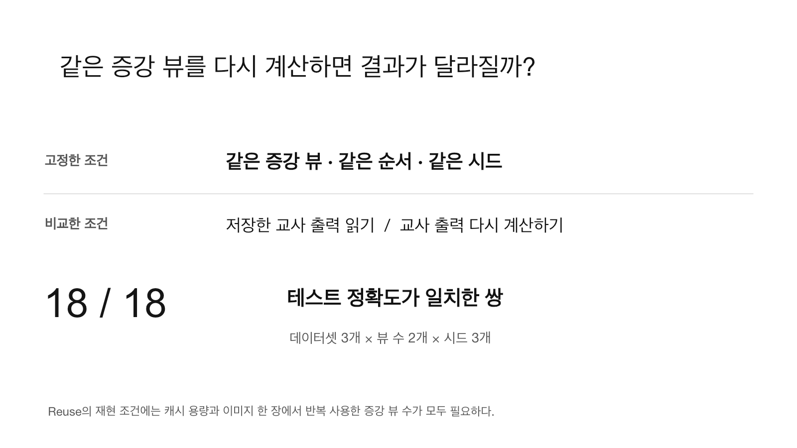

같은 증강 뷰를 같은 순서로 주고 교사 출력을 저장해 읽는 경우와 매번 다시 계산하는 경우를 짝지었다. 테스트 정확도는 18쌍 모두에서 일치했다. 이 대조가 뒷받침하는 권고는 캐시 크기와 함께 실제로 반복해 쓴 뷰 수도 기록하자는 것이다.

두 조건은 증강 뷰와 제시 순서를 공유한다. 하나는 저장한 출력을 읽고 다른 하나는 해당 입력에서 교사를 다시 실행한다. 세 데이터셋, 두 뷰 수, 세 시드의 테스트 정확도가 모든 쌍에서 일치했고 Waterbirds 최저 그룹 정확도도 시드별로 같았다. 이것만으로 Full KD와의 차이를 뷰 수 하나에 귀속할 수는 없다.

**원고 근거**　Ⅳ-2 나 · 표 5 · Ⅴ장 표 6

## 16. 학습 이미지 25%를 남길 때 무엇을 선택했는가?

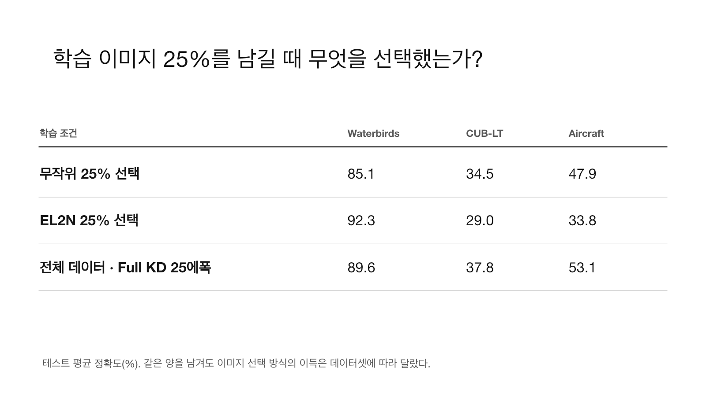

이미지의 25%만 남겨도 EL2N 선택은 무작위 선택보다 Waterbirds에서 높고 CUB-LT와 Aircraft에서 낮았다. 전체 데이터를 짧게 학습한 조건을 함께 둬, 남긴 이미지와 줄어든 갱신 횟수를 구분해 비교할 수 있게 했다.

전체 데이터를 짧게 학습한 25에폭 Full KD를 함께 읽는다. 무작위 선택은 CUB-LT와 Aircraft에서 각각 3.3%p, 5.2%p 낮았다. EL2N은 Waterbirds에서 무작위보다 높았으나 다른 두 데이터셋에서는 낮았다. CUB-LT의 실제 갱신 횟수는 600 대 625회, Aircraft는 1,100 대 1,150회로 가깝다.

**원고 근거**　Ⅳ-2 마 · 표 5 · 테스트 평균 정확도(%)

## 17. CelebA 학습 이미지를 늘려도 지표 차이는 남았다

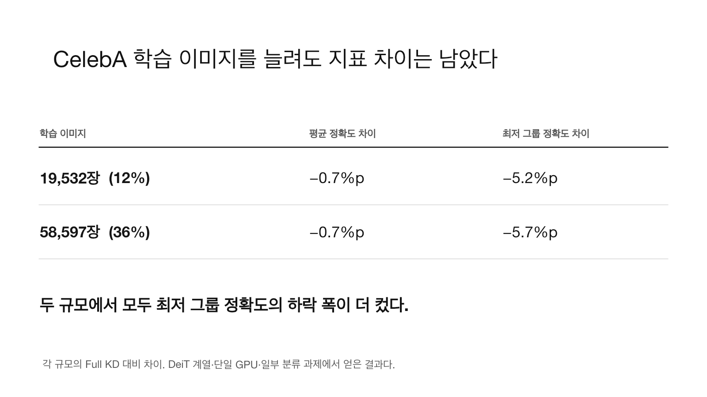

CelebA에서는 학생 갱신 횟수를 고정하고 학습 이미지 수를 약 세 배로 늘렸다. 두 규모 모두 최저 그룹의 하락이 평균 하락보다 컸다. 테스트 평가 후 설계한 후속 실험이므로, 데이터 규모가 손실을 키웠다고 결론짓기보다 앞선 관찰의 범위를 점검하는 사례로 쓴다.

학생 갱신 횟수를 고정하고 학습 이미지를 약 세 배로 늘렸다. 15% 토큰 Shrink와 해당 규모의 Full KD를 비교했다. 두 조건 모두 최저 그룹 하락이 평균 하락보다 컸고, 규모 간 하락 폭 차이 자체는 시드 변동이 커서 규모 효과로 단정할 수 없다. 이 실험은 테스트 평가 후 설계한 후속 분석이다.

**원고 근거**　Ⅳ-3 · CelebA 규모 후속 실험 · 테스트, 시드 3개

## 18. Ⅴ. 결론과 랩미팅 논의

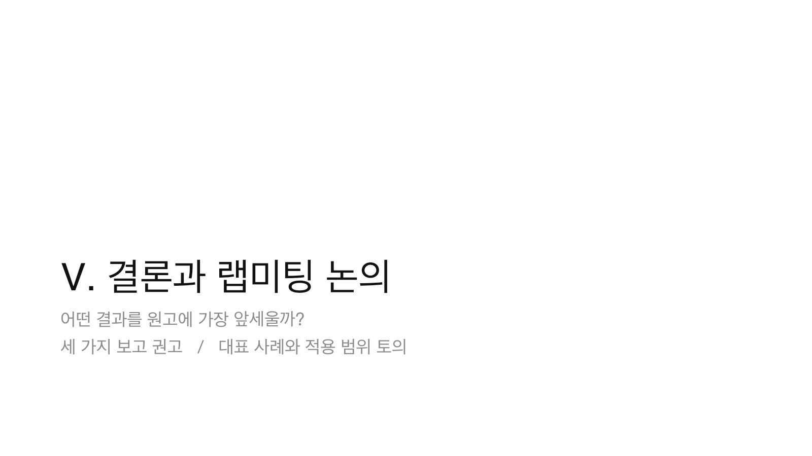

초록에는 Waterbirds의 순위 역전을 대표 사례로 둘지, CelebA 후속 결과는 논의에 남길지 의견을 구한다.

비용 범위, 비교 기준, 성능 지표라는 세 권고를 앞선 실험과 연결한다. 마지막에는 초록에 남길 사례와 결과를 일반화할 범위를 연구실에서 논의한다.

**원고 근거**　Ⅴ장 · 표 6 · Ⅳ-3

## 19. 실험 결과에서 도출한 세 가지 보고 항목

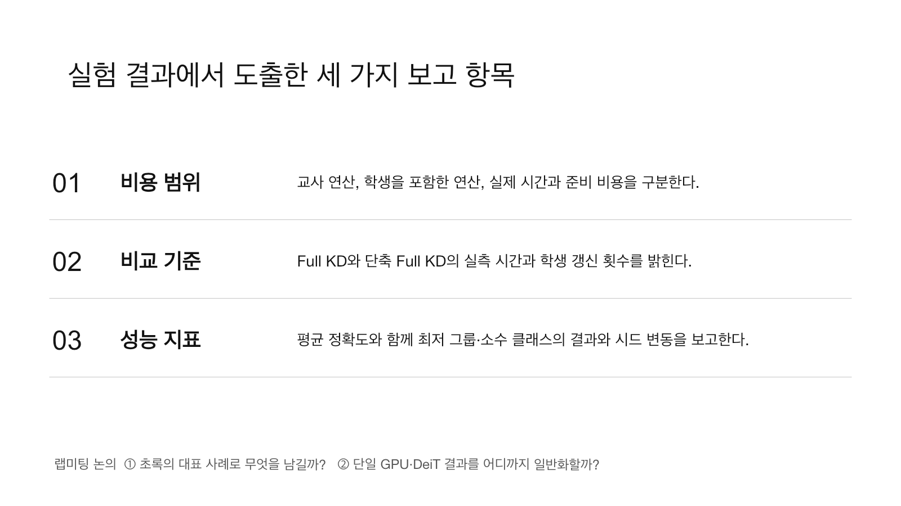

비용 범위에는 비용 실험, 비교 기준에는 단축 Full KD, 평가 지표에는 Waterbirds 결과가 각각 근거가 된다. 랩미팅에서는 이 가운데 초록에 남길 대표 사례와, 단일 GPU·DeiT 모델에서 얻은 결과를 어디까지 일반화할지 의견을 받는다.

저자라면 절감률의 범위와 준비 비용을 몇 번에 나눴는지, 어느 기준선과 몇 초 차이인지, 평균 이외의 어떤 집단에서 성능이 달라지는지를 함께 제시할 수 있다. 독자라면 같은 세 질문으로 서로 다른 연구의 숫자를 읽을 수 있다.

**원고 근거**　Ⅴ장 · 표 6 · Ⅳ-3의 한계
