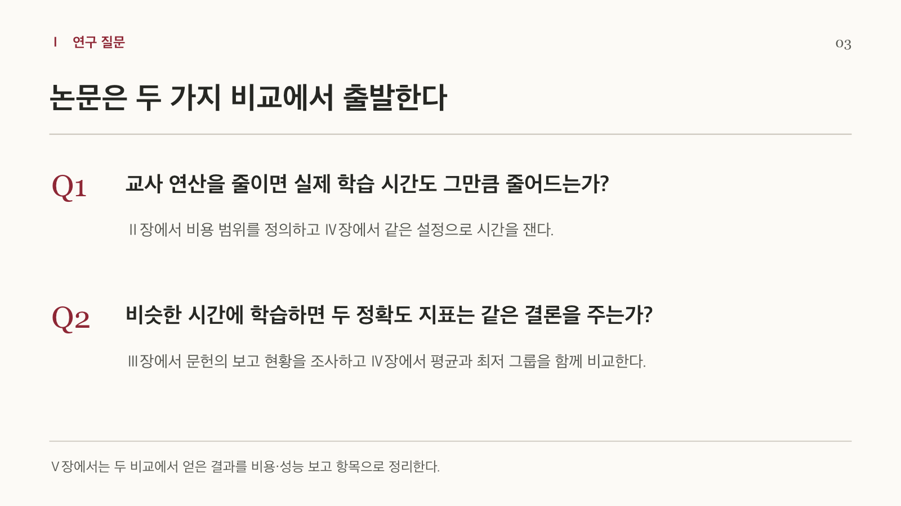
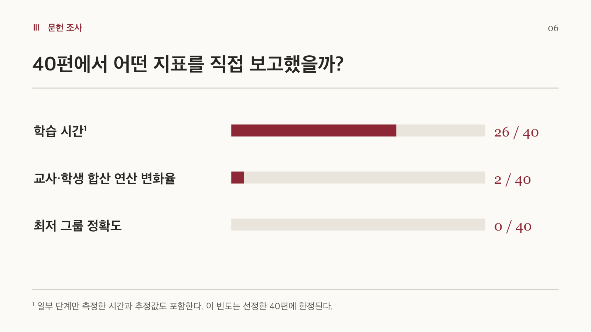
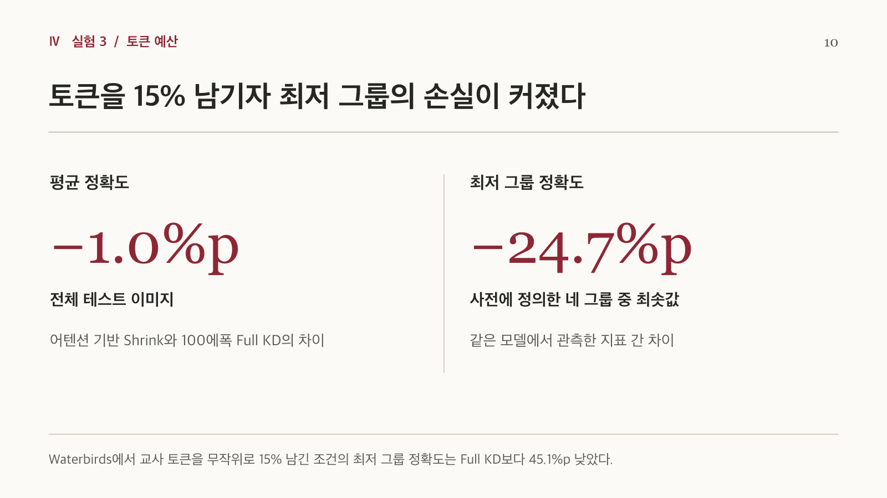
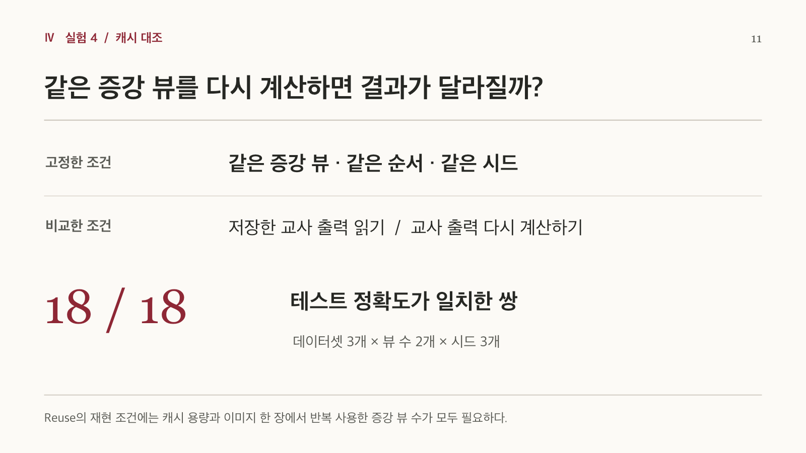
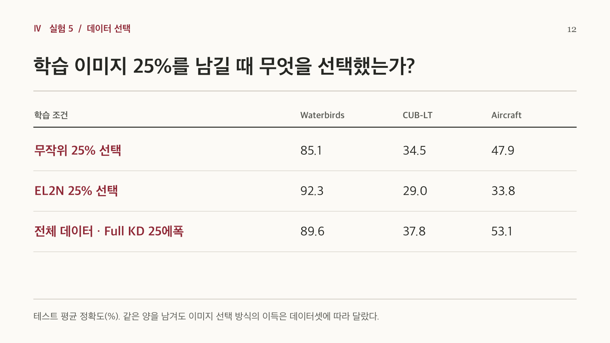
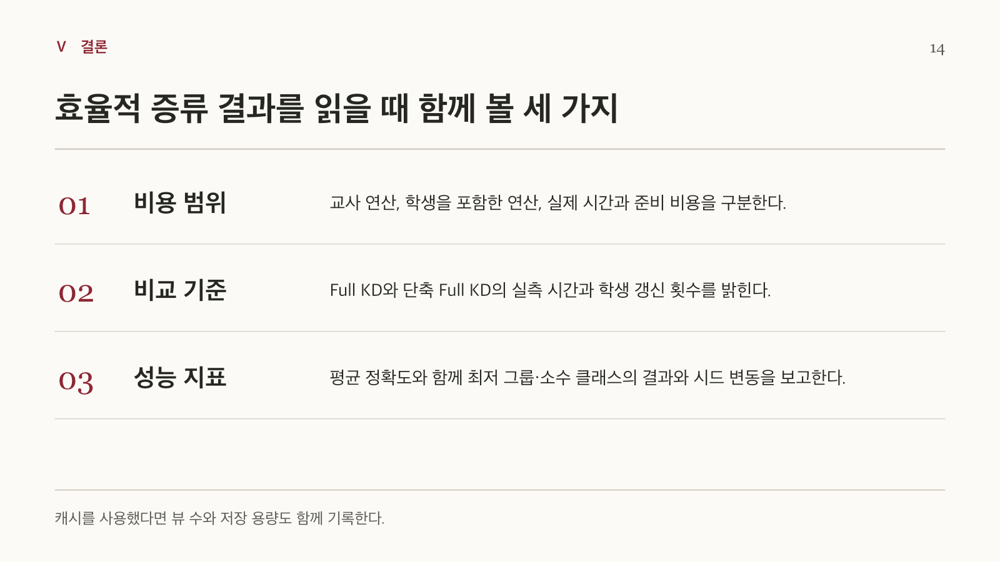

# 슬라이드별 샘플과 발표 메모
[전체 구성](README.md) · [PowerPoint](EKD-seminar.pptx)

각 슬라이드의 그림 아래에 이 장을 둔 이유, 구두 설명, 다음 장으로 넘어가는 문장과 원고 근거를 적었다.

## 01. A Survey on Efficient Knowledge Distillation for Vision

**표지**  
발표에서 말하는 효율을 학생 모델의 학습 비용으로 한정한다.

큰 교사의 예측을 작은 학생에게 전달하면 배포할 모델은 가벼워진다. 이 발표는 그 학생을 만드는 데 드는 비용과 그 대가로 달라지는 정확도를 다룬다.

**다음 장 연결**  
같은 방법에 두 절감률이 붙는 사례를 먼저 보자.

**원고 근거**  
국문 요약 · Ⅰ장

## 02. TinyViT의 학습 비용은 얼마나 줄었을까?

**Ⅰ   문제 제기**  
비용의 범위를 먼저 정의해야 한다는 논문의 출발점을 보여 준다.

온라인 증류를 기준으로 학생 반복 학습에 든 GPU-days만 비교하면 330.9에서 140.0으로 줄었다. 캐시를 만들기 위한 로짓 생성에 92.4 GPU-days가 더 든다. 이를 더해야 원 논문이 보고한 29.8%가 나온다. 교사 자체의 학습 비용은 여기서도 빠져 있다.

**다음 장 연결**  
이 차이를 비용의 문제와 성능의 문제로 나누어 질문한다.

**원고 근거**  
Ⅲ-2 · 표 3 · Wu 등, TinyViT (ECCV 2022), https://arxiv.org/abs/2207.10666

## 03. 논문은 두 가지 비교에서 출발한다

**Ⅰ   연구 질문**  
비용을 다루는 질문과 성능을 다루는 질문을 구분하고 이후 장의 역할을 예고한다.

첫 질문에 답하려면 교사 연산, 학생 연산, 경과 시간을 나눠야 한다. 둘째 질문에는 같은 기계를 쓴 대조군과 그룹별 성능이 필요하다. 이 때문에 문헌 분류 뒤에 직접 비교 실험을 배치했다.

**다음 장 연결**  
분류를 만들기 전에 비용을 세는 단위부터 정의한다.

**원고 근거**  
Ⅰ장 마지막 문단 · Ⅱ–Ⅴ장 구성

## 04. 학생 모델 한 개를 학습할 때 무엇을 셀까?

**Ⅱ   비용 산정**  
수식의 핵심을 준비 비용의 배분과 스텝마다 반복되는 비용으로 설명한다.

Full KD의 기본 스텝은 교사의 순전파와 학생의 순전파·역전파다. 기법에 따라 선택 연산과 데이터 읽기가 더해진다. 한 번 준비한 결과를 여러 학생이 공유하면 각 학생에 배분하는 준비 비용은 줄어든다. 저장 용량은 바이트로 따로 보고한다.

**다음 장 연결**  
이제 각 기법이 줄이는 항과 새로 만드는 비용을 구분할 수 있다.

**원고 근거**  
Ⅱ-2 · 식 (1) · 그림 1

## 05. 교사 호출이 줄어도 학생이 받는 신호는 다르다

**Ⅱ   네 가지 접근**  
같은 교사 예산의 의미가 축마다 다르다는 점을 실험 조건과 연결한다.

특히 이미지 Skip과 Reuse를 구분한다. Skip에서 교사를 적용하지 않은 이미지는 정답 레이블로 학습한다. Reuse는 교사를 다시 실행하지 않아도 이미 계산한 교사 출력으로 증류를 계속한다. 데이터 Skip은 이미지 자체를 빼므로 학생 갱신까지 줄어든다.

**다음 장 연결**  
이 분류를 적용해 선행 연구가 실제로 어떤 비용과 성능을 보고하는지 조사했다.

**원고 근거**  
Ⅱ-3 · 표 1 · Ⅳ-1 가

## 06. 40편에서 어떤 지표를 직접 보고했을까?

**Ⅲ   문헌 조사**  
문헌 집계를 후속 실험의 설계 근거로 제시한다.

초기 후보 44편에서 35편, 보완 검색 신규 후보 15편에서 5편을 선정했다. 합산 연산 변화율은 두 모델을 합쳐 변화를 직접 수치로 제시한 UNIX와 HACD만 집계했다. 그룹 주석의 유무는 조사하지 않았으므로 최저 그룹 정확도 0편은 보고 사례를 찾지 못했다는 뜻이다.

**다음 장 연결**  
선행 문헌의 서로 다른 설정을 한 원고에서 직접 맞춰 비교한다.

**원고 근거**  
Ⅱ-1 · Ⅲ-1 · 표 2 · 부록 표 7

## 07. 비교 대상마다 다른 질문에 답한다

**Ⅳ   실험 설계**  
표준 증류와 단축 증류를 함께 둔 이유, 세 데이터셋과 CelebA의 역할을 설명한다.

주 실험은 Waterbirds, CUB-LT, Aircraft에서 네 축을 모두 비교한다. CelebA에서는 Shrink와 이미지 Skip만 추가 평가한다. 기본 모델은 DeiT-B 교사와 DeiT-Ti 학생이며, 정확도는 조건별 3–5개 시드의 테스트 결과를 사용한다. 짧은 Full KD는 학습률 스케줄도 함께 단축했다.

**다음 장 연결**  
같은 비용 범위와 하드웨어에서 교사 연산과 실제 시간을 비교한다.

**원고 근거**  
Ⅳ-1 가–다 · 표 4

## 08. 교사 연산을 약 75% 줄이면 학습 시간은?

**Ⅳ   실험 1  /  비용 범위**  
학생 갱신 횟수를 고정해 교사 연산의 감소가 각 비용 범위에 얼마나 반영되는지 본다.

교사 연산량과 계측한 반복 연산량은 처리량으로 계산한 값이다. S3는 RTX A5000의 루프 경과 시간이다. 같은 DeiT-B 준비 비용을 학생 한 명이 전부 부담하면 총시간 절감률은 더 낮다. 작은 교사로 대체하면 준비 시간 자체가 짧아져 결과가 달라진다.

**다음 장 연결**  
그만큼 시간을 아낀 경우에도 성능 비교의 결론이 유지되는지 본다.

**원고 근거**  
Ⅳ-2 가 · 그림 2 · 학생 갱신 유지, 새 캐시 포함, 기존 캐시 재사용 및 데이터 Skip 제외

## 09. 같은 두 방법도 정확도 지표에 따라 순위가 바뀐다

**Ⅳ   실험 2  /  시간 대조**  
두 번째 연구 질문에 답하는 Waterbirds 사례를 한 화면에서 읽게 한다.

Waterbirds에서 토큰 25%를 남긴 어텐션 Shrink는 463초, 70에폭 Full KD는 487초가 걸렸다. 세 시드에서 모두 Shrink가 평균에서는 앞서고 최저 그룹에서는 뒤졌다. 시간은 근사 대조이며, 세 시드 관측을 다른 데이터셋의 보편적 순위로 해석하지 않는다. CUB-LT와 Aircraft에서는 Reuse, Substitute, 어텐션 Shrink 모두 두 단축 베이스라인보다 평균 정확도가 높았다.

**다음 장 연결**  
다음에는 토큰 예산을 더 줄였을 때 같은 차이가 얼마나 커지는지 살펴본다.

**원고 근거**  
Ⅳ-2 라 · 표 5 · 그림 4 · Waterbirds 테스트 평균 ± 시드 간 표준편차, n=3

## 10. 토큰을 15% 남기자 최저 그룹의 손실이 커졌다

**Ⅳ   실험 3  /  토큰 예산**  
한 예산에서의 순위 비교를 예산 변화에 대한 민감도로 확장한다.

이번 비교 기준은 70에폭이 아니라 100에폭 Full KD다. Waterbirds에서 어텐션으로 교사 입력 토큰의 15%를 유지했을 때 평균은 1.0%p, 최저 그룹은 24.7%p 낮았다. 무작위 선택의 최저 그룹 하락은 45.1%p였다. 어떤 토큰을 남겼는지도 성능 해석에 필요하다.

**다음 장 연결**  
다른 축에서는 교사 출력을 저장하는 방식과 증강 뷰 수를 분리해 보았다.

**원고 근거**  
Ⅳ-2 다 · 그림 3 · Waterbirds 테스트

## 11. 같은 증강 뷰를 다시 계산하면 결과가 달라질까?

**Ⅳ   실험 4  /  캐시 대조**  
캐시 사용과 제한된 증강 뷰의 반복을 구별하는 대조 실험의 논리를 설명한다.

두 조건은 증강 뷰와 제시 순서를 공유한다. 하나는 저장한 출력을 읽고 다른 하나는 해당 입력에서 교사를 다시 실행한다. 세 데이터셋, 두 뷰 수, 세 시드의 테스트 정확도가 모든 쌍에서 일치했고 Waterbirds 최저 그룹 정확도도 시드별로 같았다. 이것만으로 Full KD와의 차이를 뷰 수 하나에 귀속할 수는 없다.

**다음 장 연결**  
학습 데이터를 직접 줄인 경우에는 학생의 갱신 횟수까지 대조해야 한다.

**원고 근거**  
Ⅳ-2 나 · 표 5 · Ⅴ장 표 6

## 12. 학습 이미지 25%를 남길 때 무엇을 선택했는가?

**Ⅳ   실험 5  /  데이터 선택**  
데이터 Skip이 줄이는 학생 갱신과 이미지 선택 방식의 영향을 구분한다.

전체 데이터를 짧게 학습한 25에폭 Full KD를 함께 읽는다. 무작위 선택은 CUB-LT와 Aircraft에서 각각 3.3%p, 5.2%p 낮았다. EL2N은 Waterbirds에서 무작위보다 높았으나 다른 두 데이터셋에서는 낮았다. CUB-LT의 실제 갱신 횟수는 600 대 625회, Aircraft는 1,100 대 1,150회로 가깝다.

**다음 장 연결**  
이 관찰이 데이터 크기를 바꿔도 유지되는지는 별도의 후속 실험으로 점검했다.

**원고 근거**  
Ⅳ-2 마 · 표 5 · 테스트 평균 정확도(%)

## 13. CelebA 학습 이미지를 늘려도 지표 차이는 남았다

**Ⅳ   후속 실험  /  적용 범위**  
데이터 규모가 작은 조건에서만 관찰한 현상인지 제한된 범위에서 점검한다.

학생 갱신 횟수를 고정하고 학습 이미지를 약 세 배로 늘렸다. 15% 토큰 Shrink와 해당 규모의 Full KD를 비교했다. 두 조건 모두 최저 그룹 하락이 평균 하락보다 컸고, 규모 간 하락 폭 차이 자체는 시드 변동이 커서 규모 효과로 단정할 수 없다. 이 실험은 테스트 평가 후 설계한 후속 분석이다.

**다음 장 연결**  
마지막 장에서는 이 범위 안에서 지지되는 보고 권고만 남긴다.

**원고 근거**  
Ⅳ-3 · CelebA 규모 후속 실험 · 테스트, 시드 3개

## 14. 효율적 증류 결과를 읽을 때 함께 볼 세 가지

**Ⅴ   결론**  
논문에서 제안한 보고 항목을 앞의 비교와 일대일로 연결해 발표를 마무리한다.

저자라면 절감률의 범위와 준비 비용을 몇 번에 나눴는지, 어느 기준선과 몇 초 차이인지, 평균 이외의 어떤 집단에서 성능이 달라지는지를 함께 제시할 수 있다. 독자라면 같은 세 질문으로 서로 다른 연구의 숫자를 읽을 수 있다.

**질의응답**  
질의응답에서는 각 주장에 대응하는 표와 대조 실험으로 돌아간다.

**원고 근거**  
Ⅴ장 · 표 6 · Ⅳ-3의 한계
